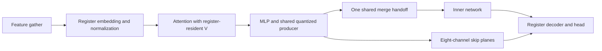

# Preset L outer blocks: RDNA4 register dataflow and RGP

The outer-block redesign reduces the matched 1080p→4K evaluation from
**4.025 ms to 3.772 ms**, a **6.28% improvement** over the original optimized
relaxed control. It is **1.91% faster** than the preceding AMD quality-budget
implementation. All **42 scored reference frames exceed 40 dB**; the worst
frame is **40.38 dB**.

The local model is `build/l-outer-rdna4-20261029/model-final`. Build it with
[build_l_outer.py](../tools/build_l_outer.py). This is a concrete change to
register ownership, prepared weights and intermediate layout, with an RGP
comparison of both fused and split dispatches. The end-to-end improvement is
still modest; it does not establish NVIDIA parity or a hardware lower bound.

## Register ownership and producer/consumer fusion

The workgroup remains an 8x8-pixel block: two wave32 waves, each owning two
4x4 windows. The ownership *inside* that tiling changes:

1. **Features and embedding stay in registers.** Each lane gathers one pixel's
   32 FP8 features; lane halves own different windows. Four exchanges of packed
   words distribute the matrix operands. The embedding feeds normalization
   directly, eliminating the shared feature and embedding round trips and their
   workgroup barriers. The old shared binary16 boundary is not enforced.
2. **V is produced in the next matrix's register layout.** Instead of computing
   weights × activations and transposing V through LDS, the shader reverses
   operand roles. It computes the logically transposed product, with activations
   as A and weights as B. On the tested gfx1201/RADV mapping, those accumulator
   elements are already the next attention product's A fragment. FP8 activation
   conversion happens directly at the producer; V never enters LDS.
3. **The residual producer quantizes once.** Its FP8 packet is reused for the
   global skip and the patch merge. The skip is stored in contiguous eight-channel
   planes rather than pixel-interleaved 32-channel records. The decoder reads
   the matching packets directly. This is a paired shader ABI change; both
   encoder and decoder variants must be rebuilt together.
4. **Only the merge needs an encoder workgroup handoff.** Features, embedding,
   normalization and attention run without workgroup synchronization. A single
   barrier remains between merge-packet stores and cross-window merge reads.



The skip still occupies **32 bytes per pixel**. Its layout changes, not its
nominal size. No reduction in DRAM bytes is claimed without cache/bandwidth
counters; the verified traffic reduction below is the removal of LDS operations.
The existing 16x16x16 WMMA tile count is unchanged by this redesign.

## Prepared normalization weights

The selected preparation folds **encoder norm 2 and both decoder norms** into
their FP8 consumer weights. Per-input-channel gains multiply the appropriate
Q/V or MLP-first-layer rows before round-to-nearest-even FP8 requantization.
Those gains become one in the prepared constants, and the matching shader
omits their loads and multiplies. Biases and the residual path remain separate.

This moves gain multiplication across an FP8 quantization boundary, so it
changes the approximation. Folding every norm into the preceding AMD path
fell to **39.40 dB** and was rejected. Encoder norm 1 also failed when tested
alone with the new register path. The selected three-norm combination reaches
**40.38 dB** on its worst temporal frame and is verified on the remaining cases.
The first encoder norm retains its runtime gain multiplication.

[fold_l_norm_gains.py](../tools/fold_l_norm_gains.py) now supports explicit
selections and records preparation and updated hashes in the model manifest.
The builder applies matching `M_AMD_FOLD_*` defines; changing only the weights
or only the shader is not a valid configuration.

## RGP verification

RGP **2.7.1.13** ran under Xvfb on warmed RADV SQTT captures of the preceding
AMD path, the redesigned fused path, and the split-feature experiment. GPU:
RX 9070 XT / gfx1201, Mesa RADV 26.2.5, default 330 W cap.

| RGP field | Previous encoder | Redesigned encoder | Previous decoder | Redesigned decoder |
|---|---:|---:|---:|---:|
| Allocated VGPRs | 240 | **120** | 120 | **120** |
| Allocated LDS / workgroup | 10,240 B | **5,120 B** | 5,120 B | **3,072 B** |
| Theoretical waves / SIMD | 6 / 16 | **12 / 16** | 12 / 16 | **12 / 16** |
| LDS instructions / sampled wave | 100 | **10** | 78 | **6** |
| Byte-wide LDS stores / sampled wave | 64 | **0** | 64 | **0** |
| Workgroup barrier pairs / sampled wave | 5 | **1** | 1 | **1** |
| WMMA instructions / sampled wave | 160 | **160** | 128 | **128** |
| Non-matrix VALU / WMMA | 13.495 | **12.466** | 11.109 | **9.961** |

The encoder eliminates 90% of its LDS issue instructions and the decoder
92.3%. Matrix work is unchanged; non-matrix VALU falls approximately 7.6% and
10.3%, respectively. Encoder register use halves. Decoder LDS shrinks without
increasing its occupancy limit, which remains constrained by registers/scalars.

These occupancy values are resource limits, not measured achieved occupancy.
Instruction counts divide RGP hit counts by sampled waves and are input- and
scheduling-dependent estimates from one shader engine. Instruction timing is
issue latency, including waits that other waves may hide; its cost percentages
are not directly removable frame time. See AMD's
[RGP Events documentation](https://gpuopen.com/manuals/rgp_manual/events_windows/).
Traced durations are excluded from the benchmark results.

## Dispatch-boundary experiment

A separate feature-gather pass was implemented and exercised through the
runtime, including its descriptor cache and temporal sequence. It writes
per-block FP8 features, followed by a compute barrier and the matrix block.
RGP shows 96 VGPRs / zero LDS for the feature pass, but the separated matrix
block still needs 120 VGPRs and has the same 12-wave limit as the fused block.

At 1080p input, including the padded block grid, this introduces a **64.49 MiB
feature buffer**, one additional dispatch and one additional barrier. Writing
and reading the buffer adds about **129 MiB of logical buffer-interface traffic**
per evaluation; that is not a measurement of DRAM traffic.

In the same interleaved experiment, the fused path took **3.755 ms** and
split features **3.853 ms**, approximately 98 us slower. Both pass the temporal
quality check. The selected implementation therefore keeps features fused,
with **16 dispatches**, while the **17-dispatch** split remains an explicit
experiment. Moving the boundary offers no additional matrix occupancy here
and costs an extra intermediate transfer.

## Paired timings and quality

Three rotated/reversed interleaved trials per model, 48 warmup evaluations and
100 measured evaluations per trial, official-probe patterned inputs and four
jitters. These are GPU evaluation costs, not game FPS. Values are medians of
trial medians; stage medians do not necessarily add to the whole-pass median.

| Matched implementation | Whole pass (ms) | Input (us) | Inner network (us) | Decoder (us) |
|---|---:|---:|---:|---:|
| Original optimized relaxed control | 4.025 | 771.3 | 1650.8 | 655.1 |
| Previous AMD quality-budget path | 3.846 | 754.2 | 1600.4 | 542.3 |
| Redesigned outer blocks | **3.772** | **700.5** | 1614.7 | **505.9** |

The new work reduces input time 7.1% and decoder time 6.7% against the preceding
AMD path. Its native inner code objects and reconstruction/downsample shaders
are unchanged from that path. Their observed timing variation is retained in
the raw trials rather than attributed to the outer-block changes.

Quality uses fixed peak 1, unclipped linear RGB, alpha excluded and FP64 MSE.
Any nonfinite RGB fails. All 42 scored frames pass 40 dB individually.

| Reference | Frames | Previous AMD worst frame | Redesigned worst frame |
|---|---:|---:|---:|
| Exact d4r D3D12, 32-frame temporal diagnostic | 32 | 40.97 | **40.38** |
| Exact d4r D3D12, moving HDR 1080p→4K | 4 | 49.77 | **49.51** |
| Exact d4r D3D12, moving HDR 720p→1440p | 4 | 49.79 | **48.79** |
| Aligned NVIDIA PTX through ZLUDA capture | 2 | 42.07 | **41.64** |

The numerical d4r D3D12 reference is distinct from the two translated NVIDIA
reference frames. The latter follow the capture log's displayed-result indices,
with only the known watermark rectangle excluded. See the
[alignment correction](l-amd-quality.md#correction-to-the-old-nvidiazluda-comparison).
The fixtures do not establish a universal 40 dB guarantee on arbitrary games,
exposure changes, LDR or lifecycle events.

## Build and reproduce

Start with a current compiled, **unfolded** L model containing FP32 bias tiles:

```sh
python3 tools/build_l_outer.py CURRENT_L_MODEL RDNA4_L_MODEL --arch gfx1201
# Or reuse the preceding AMD native layers:
python3 tools/build_l_outer.py CURRENT_L_MODEL RDNA4_L_MODEL \
  --native-layers PREVIOUS_AMD_MODEL/hip
```

The default builds `SWIN_AMD_SAT8` native layers, prepares the three selected
norms and compiles both plane layouts. The destination and any new native-build
directory must not exist. ROCm and glslangValidator are required. Use the model
with the `vkhip` runner or the existing engine model-directory configuration.

For the rejected dispatch-boundary comparison, add `--features split` and
**rebuild the engine with the current source** (`bash engine/build.sh OUT`).
The optional `enc_features_l.spv` enables the additional feature buffer,
binding and dispatch. The default fused model needs no new runtime binding.
`--fold`, `--no-fold` and `--norm-dot2` expose ablations; they do not inherit the
selected model's measured acceptance. Newly built model manifests explicitly
remain unvalidated until checked against references.

```sh
python3 tools/bench_l_amd.py --runner OUT/d4r-m --case CASE.json \
  --model previous=PREVIOUS_AMD_MODEL --model redesigned=RDNA4_L_MODEL \
  --out RESULTS --trials 3 --min-psnr 40
```

Case manifests and the reference association format are described in
[the quality-budget report](l-amd-quality.md#build-and-validate). For RGP, set
`MESA_VK_TRACE=rgp MESA_VK_TRACE_PER_SUBMIT=1` and
`RADV_THREAD_TRACE_BUFFER_SIZE=536870912`, run two evaluations and retain the
last evaluation submit. This configuration writes a trace for every submit;
benchmark separately without tracing. Inspect encoder event 6 / decoder event
24 in the fused captures, or feature event 6 / matrix event 8 / decoder event
26 in the split capture. Copy instruction timing tables using
`tools/rgp_clip.c` and analyze with `tools/rgp_instruction_mix.py`.

Machine-readable timings, per-frame quality, RGP opcode counts, resource
readings and trace/model hashes are in
[sr-l-outer-rdna4.json](benchmarks/gpu-limits-20261029/sr-l-outer-rdna4.json).
Captures, GUI exports, screenshots, models and logs remain locally under
`build/l-outer-rdna4-20261029/`.
